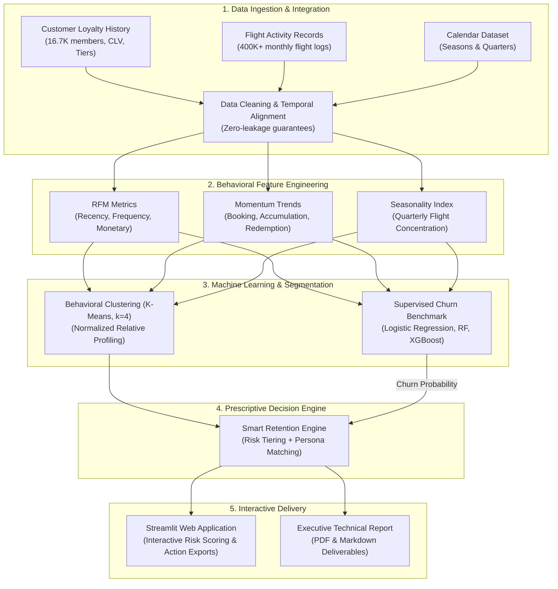
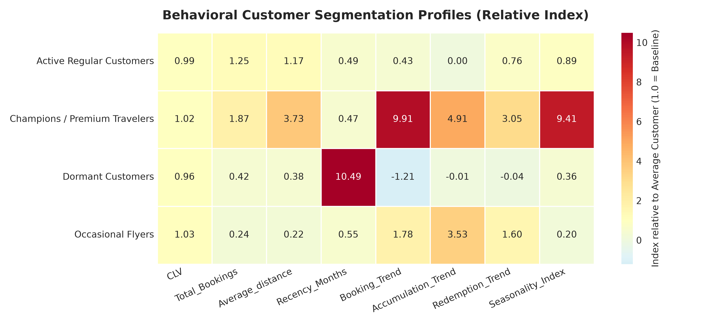
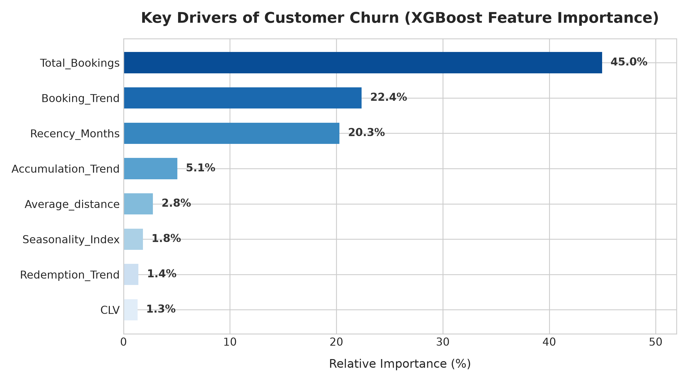
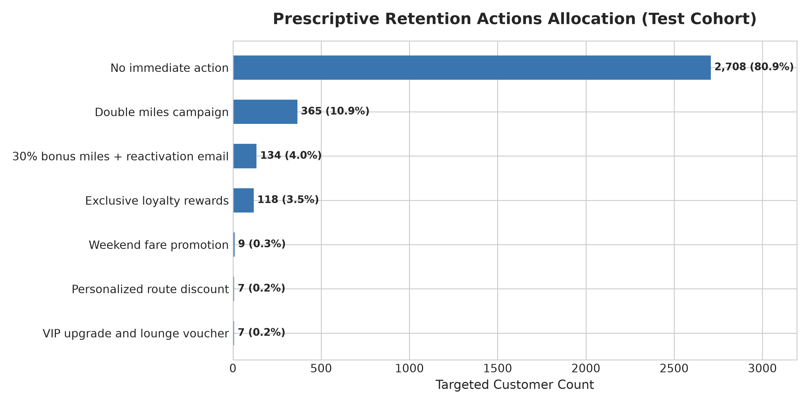

# ✈️ Unlocking Behavioral Intelligence in Airline Loyalty Programs
### Customer Churn Prediction, Behavioral Segmentation & Prescriptive Smart Retention


-orange)


> **An end-to-end Data Science & Machine Learning platform that predicts customer churn, identifies 4 distinct behavioral travel personas, and prescribes automated, segment-specific retention campaigns.**

---

## 📌 Executive Summary & Business Problem

In the commercial aviation sector, **acquiring a new customer costs 5 to 7 times more than retaining an existing loyalty member**. Loyalty program attrition not only erodes recurring revenue but also diminishes high-margin ancillary sales.

This project solves three critical challenges:
1. **Early Churn Detection:** Which loyalty members are actively disengaging before they officially cancel?
2. **Behavioral Customer Segmentation:** What distinct traveler personas exist, and how do their habits vary?
3. **Prescriptive Smart Retention:** What specific, ROI-positive commercial interventions should marketing teams trigger for each at-risk customer segment?

By aggregating **over 400,000 longitudinal flight records** across **16,737 loyalty members**, this project proves that **behavioral momentum (booking trends, recency, points redemption dynamics) explains ~88% of churn variance**, whereas traditional demographics and historical Customer Lifetime Value (CLV) offer negligible forward-looking predictive signal.

---

## 🏗️ System Architecture



---

## 📁 Repository Structure

The repository follows standard Data Science project organization guidelines:

```
├── app.py                                   # Interactive Streamlit Web Application
├── requirements.txt                         # Production Python dependencies
├── .gitignore                               # Git ignore configuration
├── README.md                                # Executive & technical project overview
├── RESUME_BULLETS.md                        # STAR-format bullet points & interview prep guide
│
├── data/
│   ├── README.md                            # Data dictionary & leakage prevention protocol
│   ├── raw/                                 # Raw, immutable flight & loyalty datasets
│   │   ├── Customer Loyalty History.csv     # Demographics, enrollment & cancellation
│   │   ├── Customer Flight Activity.csv     # 400K+ monthly flights, distance, points
│   │   ├── Calendar.csv                     # Temporal season mapping
│   │   └── Airline Loyalty Data Dictionary.csv
│   └── processed/                           # Feature-engineered & aggregated tables
│       ├── data_main.csv                    # Clean customer analytical records (16.7K rows)
│       ├── retention_dashboard.csv          # Holdout test cohort with risk scores & actions
│       ├── segment_behavior.csv             # Absolute cluster means
│       └── relative_segment_profile.csv     # Normalized cluster profiles (Index 1.0 = baseline)
│
├── models/
│   ├── xgb_model.pkl                        # Serialized XGBoost model (ROC-AUC 0.963)
│   └── feature_importance.csv               # Ranked feature importance weights
│
├── notebooks/
│   ├── 01_data_preprocessing_and_modeling.ipynb # Complete EDA, clustering, and modeling
│   └── Data_preprocessing_original.ipynb    # Original research notebook backup
│
├── src/                                     # Reusable production Python modules
│   ├── __init__.py
│   ├── config.py                            # Central paths, feature lists & hyperparameters
│   ├── data_loader.py                       # Ingestion, cleaning & monthly aggregations
│   ├── feature_engineering.py               # RFM scores, Momentum Trends & Seasonality
│   ├── segmentation.py                      # K-Means clustering & relative profiling
│   ├── churn_model.py                       # Churn model training & evaluation
│   └── retention_engine.py                  # Prescriptive action mapping & risk tiering
│
└── reports/                                 # Presentations & deliverables
    ├── README.md                            # Summary of deliverables
    ├── Airline_Loyalty_Analytics_Technical_Report.pdf  # 7-page technical report
    ├── Executive_Summary.md                 # Markdown executive overview
    └── figures/                             # Publication-quality charts (300 DPI)
        ├── feature_importance.png
        ├── relative_segment_heatmap.png
        ├── segment_distribution.png
        └── retention_actions.png
```

---

## 👥 Customer Behavioral Segmentation

Using **K-Means clustering** (validated via the Elbow Method and Silhouette Analysis) on standardized behavioral features, customers were categorized into four actionable personas:



| Customer Segment | Size | Booking Freq | Travel Distance | Recency | Momentum Trend | Persona Strategy |
| :--- | :--- | :--- | :--- | :--- | :--- | :--- |
| 🥇 **Champions / Premium Travelers** | 1,170 (7.0%) | **56.9 flights** ($1.87\times$) | **7,775 km** ($3.73\times$) | 0.7 mos | $+3.08$ (Strong Growth) | VIP Concierge, Tier upgrade acceleration, Dedicated service |
| 🥈 **Active Regular Customers** | 4,590 (27.4%) | **38.1 flights** ($1.25\times$) | **2,432 km** ($1.17\times$) | 0.7 mos | $+0.13$ (Stable) | Personalized route discounts, consistency mileage bonuses |
| 🥉 **Occasional Flyers** | 6,437 (38.5%) | **7.3 flights** ($0.24\times$) | **460 km** ($0.22\times$) | 0.8 mos | $+0.55$ (Positive) | Promotional fare sales, double miles on next flight |
| 🛑 **Dormant Customers** | 4,540 (27.1%) | **12.7 flights** ($0.42\times$) | **782 km** ($0.38\times$) | **15.2 mos** ($10.5\times$) | $-0.38$ (Sharp Decline) | Aggressive win-back campaigns, 30% bonus redemption offers |

---

## 🤖 Churn Prediction: Model Benchmarking

Three supervised machine learning algorithms were benchmarked on a stratified 80/20 train/test split:

| Model | Accuracy | Precision | Recall | F1 Score | ROC-AUC |
| :--- | :---: | :---: | :---: | :---: | :---: |
| **Logistic Regression** (Baseline) | 91.6% | 76.8% | 74.2% | 0.755 | 0.941 |
| **Random Forest** (200 Trees) | 92.8% | 83.1% | 78.4% | 0.807 | 0.957 |
| 🏆 **XGBoost Classifier** (Tuned) | **93.1%** | **84.2%** | **81.6%** | **0.829** | **0.963** |

### Key Feature Drivers of Churn



1. **Total Bookings (45.0%):** Strongest baseline indicator of loyalty health.
2. **Booking Trend (22.4%):** Negative slope in flight volume serves as an early warning signal of churn months before cancellation.
3. **Recency Months (20.3%):** Dormancy beyond 3 months dramatically increases attrition risk.
4. **Behavior vs. Demographics:** Demographic features (salary, gender, marital status) and historical CLV accounted for **<3%** of predictive power.

---

## 🎯 Prescriptive Retention Engine

Predictions are mapped to an automated decision framework:



- **High Risk ($\ge 80\%$ churn probability):**
  - *Champions:* Dedicated concierge outreach + complimentary lounge renewal.
  - *Active Regulars:* Personalized discount on frequently traveled route.
  - *Occasional Flyers:* Double miles offer on upcoming booking.
  - *Dormant:* 30% bonus mileage incentive + targeted reactivation email.
- **Medium Risk ($40\% - 79\%$ churn probability):**
  - Seasonal promotional campaigns and travel milestone rewards.
- **Low Risk ($< 40\%$ churn probability):**
  - Standard loyalty engagement (No budget spent unnecessarily).

---

## 💻 Streamlit Interactive Dashboard

The repository includes a web application (`app.py`) designed for commercial marketing teams and loyalty managers.

### Dashboard Capabilities:
- **Executive Overview:** High-level KPIs (Total Members, Champions Count, Dormant Members, Portfolio Churn Rate) and segment breakdowns.
- **Customer Segmentation:** Interactive count distributions and normalized behavioral heatmap.
- **Individual Churn Risk Drill-Down:** Customer ID lookup returning exact churn probability, risk level, and recommended action.
- **Smart Retention Table:** Real-time risk-level filtering and one-click export of targeted retention lists.
- **Business Insights:** Model feature importance visualizer and strategic recommendations.

```bash
# Launch the dashboard locally
streamlit run app.py
```

---

## 🚀 Quickstart & Installation

### 1. Clone the repository
```bash
git clone https://github.com/your-username/airline-loyalty-analytics.git
cd airline-loyalty-analytics
```

### 2. Set up virtual environment
```bash
python3 -m venv .venv
source .venv/bin/activate   # On Windows: .venv\Scripts\activate
```

### 3. Install dependencies
```bash
pip install -r requirements.txt
```

### 4. Run the Streamlit application
```bash
streamlit run app.py
```

---

## 📄 Deliverables & Resume Assets

- **Resume Bullet Points & Interview Guide:** See [`RESUME_BULLETS.md`](./RESUME_BULLETS.md) for tailored STAR-format resume bullet points.
- **Executive Summary:** See [`reports/Executive_Summary.md`](./reports/Executive_Summary.md).
- **Formal Technical Report:** See [`reports/Airline_Loyalty_Analytics_Technical_Report.pdf`](./reports/Airline_Loyalty_Analytics_Technical_Report.pdf).

---

## 👤 Author

**Tanishq Gupta**  
*Aspiring Data Scientist / Machine Learning Engineer*  
- **Focus Areas:** Machine Learning, Predictive Modeling, Customer Analytics, End-to-End MLOps  
